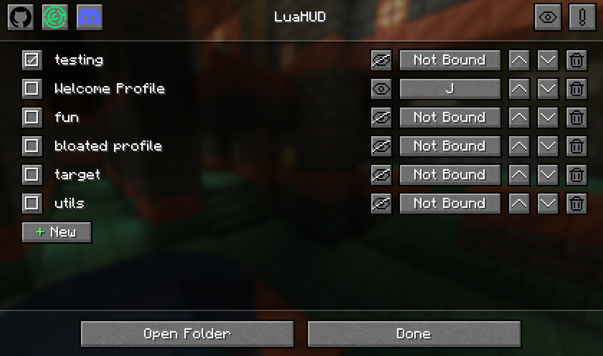

*I typed `luahud/...` instead of `<minecraft directory>/config/luahud/...` below to avoid repetition.*

To open the mod screen:

- Press **H** in-game (the default keybind), or
- Open LuaHUD through [Mod Menu](https://modrinth.com/mod/modmenu).

:::tip
Use the mod screen for file operations, otherwise profile settings may reset.
:::

Every profile is a `.lua` file under `luahud/profiles/` directory. You can click **Open Folder** on the mod screen to open this directory in your file manager.

Profiles are compiled once, and listen to specific callbacks that they subscribed to until they are disabled.

When you save a profile, it reloads automatically, so you don't need to manually reload every time you make a change.

---

:::caution
You should open directly the `luahud` directory in your code editor instead of `luahud/profiles` or a singular file. Otherwise you **WONT** be able to see API definitions.
:::

API definitions are under `luahud/api/`, and system scripts are under `luahud/system/`.

Now continue to [About Lua](/lua/about-lua) to learn what actually is lua
