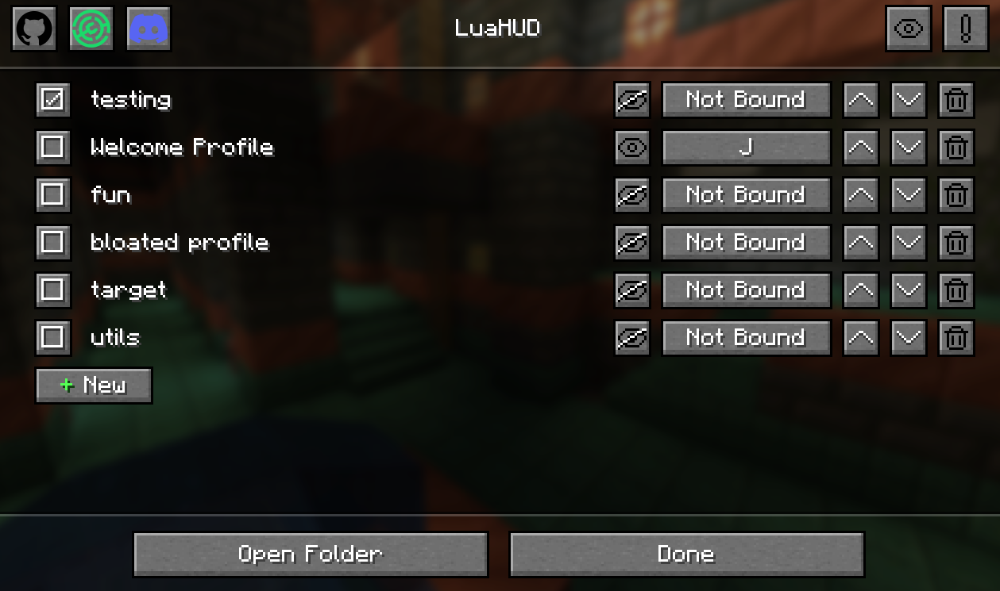

To open the mod screen:

- Press **H** in-game (the default keybind), or
- Open LuaHUD through [Mod Menu](https://modrinth.com/mod/modmenu).

Profiles are `.lua` files in `<minecraft directory>/config/luahud/`. Click **Open Folder** on the mod screen to open this directory in your file manager.

:::tip
Saving a `.lua` file automatically reloads your profiles. Use the mod screen to create, rename, and delete profiles so their keybinds, visibility, enabled state, and order stay associated with the correct profile.
:::

:::tip
Open the entire profile directory in your code editor instead of a single file. With a Lua language server enabled, the generated API definitions provide code completion for LuaHUD and IDs from your installed mods.
:::
