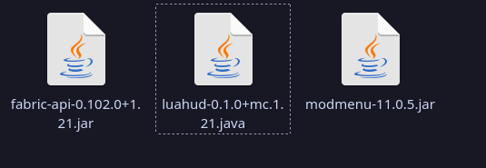

## Fabric
LuaHUD is a [Fabric](https://fabricmc.net) mod. This means you need to launch Minecraft with Fabric Loader to use it.

## Locating the game directory
The location may change depending on your operating system and how you downloaded Minecraft.
Most common ones:

**Windows**
```text
%appdata%\.minecraft\
```

**Windows (Prism Launcher)**
```text
%appdata%\PrismLauncher\instances\<your instance name>\minecraft\
```

**Linux**
```text
~/.minecraft/
```

**Linux (Prism Launcher)**
```text
~/.local/share/PrismLauncher/instances/<your instance name>/minecraft/
```

**Linux (Prism Launcher with Flatpak)**
```text
~/.var/app/org.prismlauncher.PrismLauncher/data/PrismLauncher/instances/<your instance name>/minecraft/
```

**MacOS:**
LuaHUD has not been tested on macOS. Use your launcher to open the instance's Minecraft folder; its location depends on the launcher.

:::tip
In Prism Launcher, you can also find the game directory by right-clicking the instance and selecting **Folder**. 
:::

## Required mods
Download versions of these mods that match your Minecraft version, and place their `.jar` files in `<minecraft directory>/mods/`:

* [Fabric API](https://modrinth.com/mod/fabric-api)

* [LuaHUD](https://modrinth.com/mod/luahud) (the mod itself)

* [Mod Menu](https://modrinth.com/mod/modmenu) is optional but recommended for opening mod settings.


Launch the instance with Fabric Loader and enter a world. If LuaHUD appears in the mod list, continue to [Accessing Files](/getting-started/accessing-files/) to find your profiles, or follow [Your First HUD](/guides/your-first-hud/).
