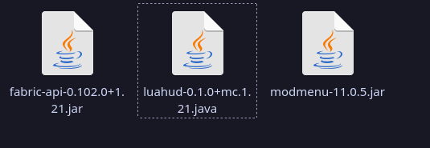

Nothing so crazy here, just a fabric mod installation. You can skip to [Accessing Files](/getting-started/accessing-files), if you already know these.

## Fabric
LuaHUD is a [Fabric](https://fabricmc.net) mod. This means you need to launch Minecraft with Fabric Loader to use it.

## Locating the game directory
The location may change depending on your operating system and how you downloaded Minecraft.
Most common ones:

**Windows**
```text
%appdata%\.minecraft\
```

**Windows (Prism Launcher)**
```text
%appdata%\PrismLauncher\instances\<your instance name>\minecraft\
```

**Linux**
```text
~/.minecraft/
```

**Linux (Prism Launcher)**
```text
~/.local/share/PrismLauncher/instances/<your instance name>/minecraft/
```

**Linux (Prism Launcher with Flatpak)**
```text
~/.var/app/org.prismlauncher.PrismLauncher/data/PrismLauncher/instances/<your instance name>/minecraft/
```

:::tip
In Prism Launcher, you can also find the game directory by right-clicking the instance and selecting **Folder**. 
:::

## Required mods
Download versions of these mods that match your Minecraft version, and place their `.jar` files in `<minecraft directory>/mods/`:

* [LuaHUD](https://modrinth.com/mod/luahud) (the mod itself)

* [Fabric API](https://modrinth.com/mod/fabric-api)

* [Mod Menu](https://modrinth.com/mod/modmenu) is optional but recommended for opening mod settings.


Launch your game with Fabric Loader. If you see LuaHUD on the mod list, continue to [Accessing Files](/getting-started/accessing-files/)
