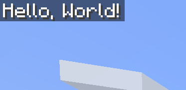

`lh` is the global API for **L**ua**H**UD.

## Create a profile

After [installing LuaHUD](/getting-started/installation/), enter a world and open the mod screen with **H**. Create a profile, then use **Open Folder** to find its `.lua` file in the [profile directory](/getting-started/accessing-files/). Open it in a text editor and make sure the profile is enabled.

Save each example in that file. LuaHUD reloads profiles when you save, so you can see the result in-game without restarting Minecraft.

LuaHUD can draw text, items, textures, and entities on your HUD. Start with text below, then explore [Items, Texture, and Entities](/guides/icons-and-models/).

Let's draw `"Hello, World!"`:
```lua
lh.draw("Hello, World!")
```



## Rows
Let's add another row:
```lua
lh.drawln("Hello, World!") -- Use lh.drawln instead of lh.draw to add a new line
lh.draw("Hello, " .. lh.player.name)
```


Or you can do
```lua
lh.draw("Hello, World!")
lh.newline() -- One line break; pass a count for multiple line breaks.
lh.draw("Hello, " .. lh.player.name)
```


## Make it update
Code at the top level runs **once when the profile loads**. This is fine for a greeting, but if you read FPS there, the displayed number will stay at its initial value.

Replace the file with:
```lua
lh.on("tick", function()
    lh.drawln("Hello, World")
    lh.drawln("FPS: " .. lh.perf.fps)
    lh.drawln(string.format("XYZ: %.1f / %.1f / %.1f",
        lh.player.x, lh.player.y, lh.player.z))
end)
```
`lh.on()` registers a callback. `"tick"` runs at the end of each client tick, so now the script reads fresh values regularly.

The drawing from this callback is replaced each time it runs. You don't have to erase the previous text yourself, and the rows won't keep piling up.

## Show something only when it matters
Here's a health warning. Replace the previous example with this, or add the condition inside its callback:
```lua
lh.on("tick", function()
    local health = lh.player.health

    if health <= 6 then
        lh.drawln("Health is getting low: " .. health, {
            textColor = "#FF5555",
        })
    end
end)
```
Health uses Minecraft health points: the usual full health is 20, or 10 hearts. The second argument is an optional table of drawing options.

When health rises above 6, the callback runs without drawing anything. Its previous output is still cleared, so warning disappears.

:::tip
Try examples one at a time while learning. Two separate callbacks both start at default topLeft position, so their output can overlap. Use [Sections and Layout](/guides/sections/) to give each part a place.
:::
